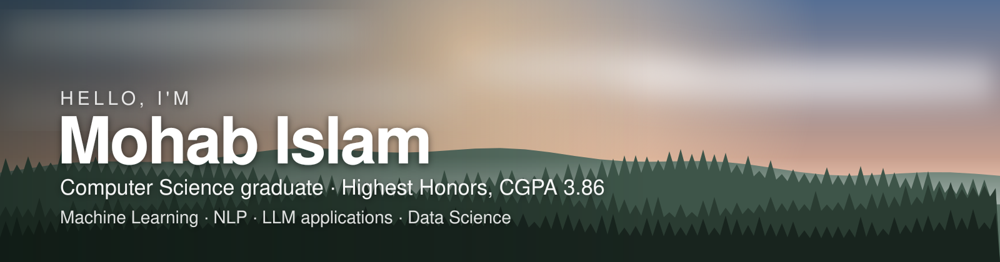

 

**I take machine-learning ideas all the way to production.** From training models to wiring LLMs into real products: data pipelines, APIs, cloud deployment, and the dashboards people actually use.

📍 Cairo, Egypt &nbsp;·&nbsp; 🎓 Nile University, BSc Computer Science (Highest Honors) &nbsp;·&nbsp; 🌍 Exchange at FH Upper Austria

 

---

## 🧑‍💻 About

Computer Science graduate with **Highest Honors (CGPA 3.86)**, specialising in **machine learning, AI and data science**. My experience spans the whole data-to-deployment path: building and training ML models, then integrating **large language models** into production-ready systems. During an exchange semester at **FH Upper Austria** I worked on research-focused projects and, as an intern, on an **LLM-assisted maintenance system** for an Austrian company.

Currently: **AI Automation Specialist**, building LLM and Python pipelines for SEO analytics. Completed the **DEPI Machine Learning programme** (Nov 2025 – Jul 2026).

## 🧭 Featured projects

<table>
<tr>
<td width="50%" valign="top">

### [ScholarPilot](https://github.com/mohab-islam/scholarpilot)
**An always-on scholarship co-pilot.** Parallel Gemini agents find scholarships you are eligible for, read official pages into a requirements checklist, research professors, and draft letters in your own voice. A Gmail watcher updates application statuses by itself.

`Python` `FastAPI` `Vertex AI` `SQLite` `Chrome MV3` `Docker` `GCP`

Highlights: live deadline countdown · version-controlled letters with diffs · tested, CI-checked, one-VM deployment with HTTPS and login.

</td>
<td width="50%" valign="top">

### [WasteMaster](https://github.com/mohab-islam/WasteMaster)
**A gamified smart recycling bin (graduation project).** YOLOv8 classifies waste on a Raspberry Pi, the backend issues one-time reward QR tokens over REST with an MQTT bridge, and a Flutter app turns recycling into points, leaderboards and challenges.

`YOLOv8` `Raspberry Pi` `Node.js` `MongoDB` `MQTT` `Flutter`

Highlights: full hardware-to-app pipeline · single-use token claims · end-to-end verification script.

</td>
</tr>
<tr>
<td width="50%" valign="top">

### [Secure Multi-Client Chat](https://github.com/mohab-islam/Multi-Client-Chatting-Application)
**Encrypted LAN chat** built for a computer-networks course: threaded TCP server, Fernet-encrypted messages, authentication, private `@user` messages and persistent history, with a Tkinter GUI.

`Python` `Sockets` `Cryptography` `Tkinter`

</td>
<td width="50%" valign="top">

### [DEPI Machine Learning Track](https://github.com/mohab-islam/GIZ4_AIS2_S1_ML)
**Coursework from the Digital Egypt Pioneers Initiative (Round 4).** Python, OOP, NumPy, Pandas and data pre-processing notebooks with assignments and a final project, organised by module.

`Python` `NumPy` `Pandas` `Jupyter`

</td>
</tr>
</table>

## 💼 Experience

| When | Role | What I did |
|---|---|---|
| **Feb 2026 – now** | **AI Automation Specialist**, Fantastic Services (London area) | Built internal web tools and dashboards (TypeScript, full-stack) from SEO workflows; automated reporting, data extraction and site audits with Python pipelines and LLMs; deployed cloud workflows for continuous monitoring and keyword tracking. |
| **Nov 2025 – Jul 2026** | **Machine Learning Intern**, Digital Egypt Pioneers Initiative (DEPI) | Completed the full-stack ML curriculum: Python, data analysis, machine learning, deep learning and MLOps, with a deployable capstone per phase. |
| **Dec 2024 – Feb 2025** | **Software Engineering Intern**, RICO Elastomere Projecting GmbH (Austria) | Joint project with AIST on an AI-driven system for maintenance workflows: database mapping for the UI and LLM-based generation of maintenance instructions. |
| **Sep – Oct 2024** | **MEAN Stack Trainee**, Information Technology Institute (ITI) | REST APIs with Node.js/Express, Angular interfaces, MongoDB. |
| **Jun 2023 – Sep 2024** | **Junior SEO**, Fantastic Services | Link-building strategy that lifted organic rankings by **25%**; on-page optimisation and rank reporting. |
| **Jun 2023 – Jan 2024** | **Programming Instructor**, Algorithmics | 30+ Python and Scratch sessions for 80+ students aged 6–17, with a **95%** parent satisfaction rate. |
| **Oct 2022 – Jun 2023** | **Junior Teaching Assistant**, Nile University | Supported intro programming, computer systems and intermediate programming courses; contributed to a **20%** improvement in student performance. |

## 🏆 Recognition and credentials

- 🥇 **1st place**, 15th Undergraduate Research Forum
- 🥈 **2nd place**, NASA International Space Apps Challenge (regional qualifiers)
- 🏅 **5th place**, International Science and Engineering Fair (regional qualifiers)
- 🎖️ Nile University **Achievements Day** and **Junior Teaching Assistants** honorings
- 📜 IELTS **Band 7**
- 🗣️ Arabic (native) · English (full professional)

## 🎓 Education

- **Nile University**, BSc Computer Science, 2021 – 2026, **Highest Honors (CGPA 3.86)**
- **FH Upper Austria**, exchange semester (Media Technology and Design), Sep 2024 – Feb 2025
- Red Sea STEM High School, 2018 – 2021

## 🧰 Skills

| | |
|---|---|
| **LLM engineering** | Prompt design and structured (JSON) extraction · web-grounded, retrieval-augmented generation pipelines (fetch → clean → ground → generate) · multi-agent orchestration · Gemini on Vertex AI · integrating LLMs into production systems |
| **Machine learning** | Supervised learning with scikit-learn · data pre-processing and cleaning · exploratory analysis (NumPy, Pandas) · linear algebra foundations |
| **Deep learning and vision** | Object detection with YOLOv8 (Ultralytics, PyTorch-based) · OpenCV inference pipelines · deep-learning module of the DEPI ML programme |
| **MLOps and deployment** | Docker · GitHub Actions CI · pytest · FastAPI services · Google Cloud (Compute Engine, Vertex AI, IAM, budgets) · HTTPS reverse proxy (Caddy) · continuous monitoring pipelines |
| **Data engineering** | SQL · SQLite · MongoDB · Python ETL and reporting pipelines · REST APIs · MQTT |
| **Languages** | Python · C++ · SQL · TypeScript / JavaScript · Dart |
| **Edge and IoT** | Raspberry Pi · Arduino |
